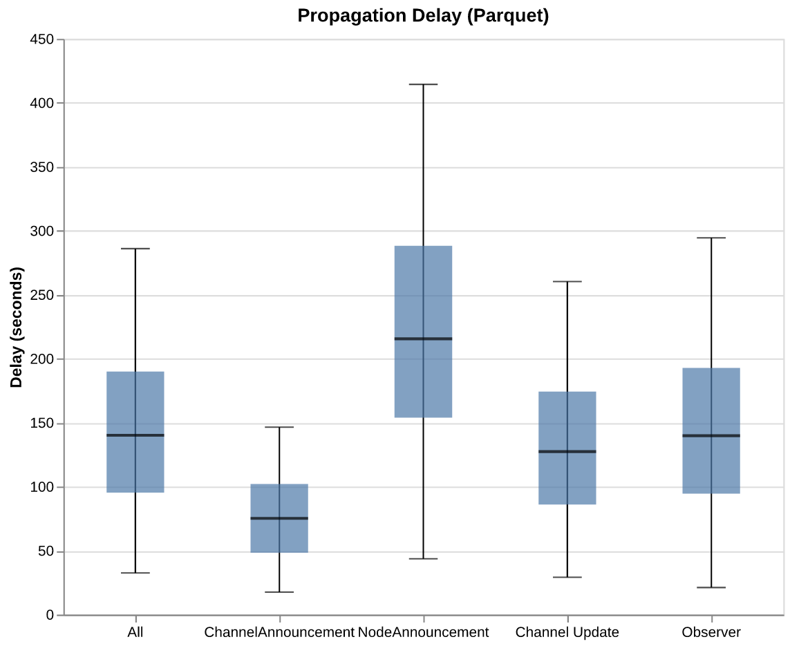
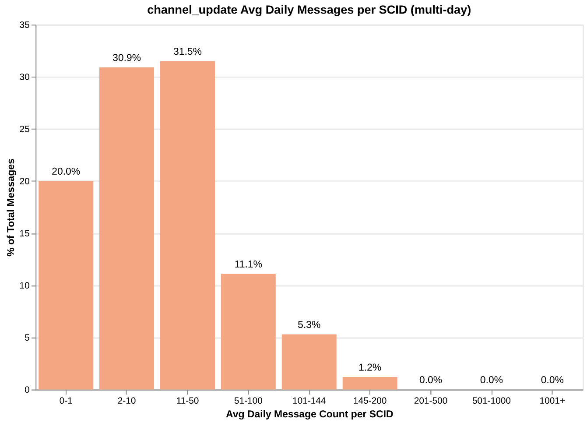
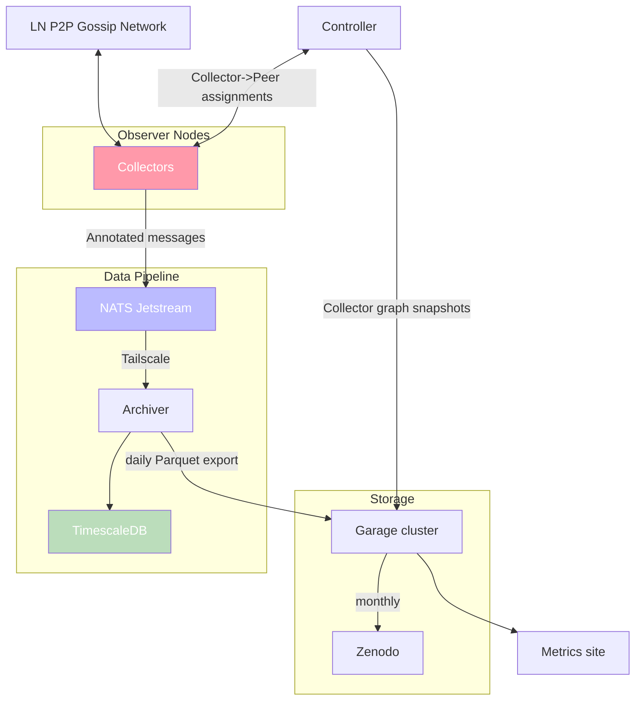

# Gossip Observer

A project to collect LN gossip traffic and compute useful metrics to inform a set-reconciliation based protocol (Erlay-like) to replace message flooding.
This project is inspired by earlier measurements of the LN gossip network<sup>[[1]](#ref-1)</sup>, simulations of alternative gossip behavior (spanning tree, set reconciliation)<sup>[[2]](#ref-2)</sup>, and work on adapting Minisketch for LN gossip<sup>[[3]](#ref-3)</sup>.

We've run ~20 collectors since February 2026. The collected data is [on Zenodo](https://doi.org/10.5281/zenodo.23111325),
and is also used to compute various metrics you can find at <https://gossip-observer.jharveyb.xyz>. In parallel, work on a new gossip protocol is happening in this [draft BOLT](https://github.com/jharveyb/bolts/blob/gossip_minisketch_draft/bolt-gossip-minisketch.md) document; feedback welcome.

## Data

There are multiple options for accessing this dataset.

- **Zenodo** (updated monthly): <https://doi.org/10.5281/zenodo.23111325>. 2026-02-05 to 2026-09-30, ~133 GB of compressed Parquet, one ZIP per table per month.
- **S3 bucket** (updated daily): <https://observer-data.jharveyb.xyz/>, updated automatically and files are per-table per-day Parquet. Also stores the dumps of the collector's gossip graphs. Contact me for read-only credentials (Open an issue! Or use another channel).
- **Metrics** (updated ad-hoc): <https://gossip-observer.jharveyb.xyz>. Convergence, unique message rates, bandwidth, channel open/close stats, graph size, anomalies, and more over 1-90 day windows. There are some CSVs here you can pull to get the input data for the figures.

In general, collector nodes record the timestamp and sending peer of a received message, plus the decrypted message bytes.

There are 5 tables: `timings` (one row per collector/peer/message receipt, µs timestamps; ~90% of the data), `messages` (raw bytes),
`metadata` (message type, size, SCID, etc.), `message_hashes` (hash with and without timestamp field), and `message_first_seen`. `collectors.csv` lists our collectors and the channels they own.

Schema, file layout, and query gotchas: [analysis/README.md](analysis/README.md). Packet captures of collector connections can be arranged, on request.

If you use the data, please cite it; BibTeX is [below](#citing).
For earlier gossip archives without per-peer timing, see the lnresearch topology dataset<sup>[[1]](#ref-1)</sup>. I also have comparable graph snapshots, but not published on Zenodo currently.

## Results

See the [metrics site](https://gossip-observer.jharveyb.xyz) for current numbers. Some highlights from the two weeks of 2026-09-15 to 2026-09-28,
across 19 collectors with ~590 peer connections total:

We received ~394k unique gossip messages per day, for a total size of ~85 MB/day (including signatures).

### How long did it take a message to reach our peers?

Delay from first receipt at any collector, capped at 1 hour, for messages sent to us by at least 100 peers. "Observer" is gossip created by us, from our own collectors' channels.
The median is 140 s overall; node announcements are the slowest at 216 s.



### Over all SCIDs, how many channel updates per day were related to that SCID?

87 of ~38k SCIDs (0.2%) averaged more than 50 updates/day, and sent 17.6% of all channel updates.



Our first 23.5-hour run (Sept 2025, discussed on [Delving Bitcoin](https://delvingbitcoin.org/t/gossip-observer-new-project-to-monitor-the-lightning-p2p-network/2105)) is on the [`exported_data` branch](https://github.com/jharveyb/gossip_observer/tree/exported_data/data/mainnet/gossip_archives/dump_0926T195046), with charts in `query_results/0926T195046/`.

## Architecture



- The collector embeds a fork of ldk-node that logs every gossip message it receives with the sending peer and receive timestamp,
and exports those to NATS. Some collectors have a channel, so we can watch our own gossip propagate by updating those channel fees regularly and generating new gossip messages.

- The controller assigns peers to collectors. Peers are spread across communities of the public graph (generated using nested SBM,
see `query_results/`) rather than just the biggest nodes. It also tracks collector health and snapshots each collector's graph for archival.

- The archiver handles medium-term storage, receiving new data from NATS and writing to TimescaleDB. It also exports each day's data to Parquet files, uploads those to S3, and later drops old chunks from the DB. TimescaleDB is used here mostly for its compression, not for live queries.

- Tailscale is used as a P2P VPN here due to convenience; Nebula or vanilla Wireguard would also work.

## Layout

gossip_collector/, observer_controller/ - Explained above.

gossip_archiver/ - Archiver daemon + `backfill_exports` CLI, for converting old exports to the current format.

observer_common/ - Shared types, gRPC protos, S3 uploader.

analysis/ - DuckDB + Polars + Altair queries over the Parquet exports ([README](analysis/README.md)), and the
metrics site pipeline ([gossip_metrics](analysis/gossip_metrics/README.md)).

infra/ansible/ - Deployment playbooks ([README](infra/ansible/README.md), [DEPLOY.md](DEPLOY.md)) and instructions on how to access the Garage S3 bucket (once you have a key) ([DATA_SHARING.md](infra/ansible/DATA_SHARING.md)).

query_results/ - Graph community detection ([notes](query_results/notes.md)) and older query output.

gossip_analyze/, electrum-cli/ - Small CLIs for peer lists, chain lookups, and graph dump validation.

### Development environment

You can use the Nix flake, or see the commonly-used tools there.
For development without the integration tests, you need Rust + `just` + `sqlx`.
For data analysis and pulling Parquet from Garage, we suggest `duckdb` and `rclone`.

- One-off shell: `nix develop`
- Auto-load on cd: install [direnv](https://direnv.net) +
  [nix-direnv](https://github.com/nix-community/nix-direnv), then run
  `direnv allow` once in the checkout.

CPU should meet the x86-64-v3 uarch level for using the Nix config.

**Remote dev box**: Use debian stable + run `infra/ansible/devbox_init.yml` (see the playbook header for prerequisites).
Clone the repo there, `direnv allow`, and attach with VS Code **Remote-SSH** — the VS Code
server installs itself on first connect, and the Claude Code extension and its
sessions then live on the VM (usable with Claude Code Remote Control). Keep
long builds and integration tests in `tmux` (`tmux new -As work`) so they
survive disconnects. For a local TimescaleDB (`just gen-sql`), add the host to
the `[timescale]` inventory group and run `timescaledb_init.yml`.

Smoke test commands:

```bash
nix develop
cargo clippy --workspace
cargo test --workspace
just integration-test
```

### Running your own deployment

Everything is deployed with Ansible; [infra/ansible/README.md](infra/ansible/README.md) lists the playbooks in order
(NATS → TimescaleDB → archiver → collectors → controller). `just integration-test` runs a controller + collector pair
on regtest. Config is TOML (`*_config.toml`), overridable with env vars.

## TODOs

- Add some support for using Core Lightning or LND as collectors.
- Ingest ldk-node debug logs to monitor for peer churn or other behavior.
- Add collectors that fully verify channel_announcements.
- How can we detect interesting patterns, without knowing what we're looking for?

## Implementation Behavior

### LND

v0.19: Outbound 1 MB/s ratelimit. Maintain 3 'active' peers that we receive gossip messages from,
and may query for historical / missing data. Maintain a separate 'passive' set that we reply to,
but will not query for messages. Active peers are rotated / randomized every 20 minutes. Downrank
or ban peers that forward duplicate, stale, premature, or invalid messages. Messages are broadcast over 90 seconds in 5 second batches. Process channel
announcements before updates or node announcements.

2022 behavior: Target 3 peers total, rotate every 20 minutes. Messages are broadcast over 90 seconds in 5 second batches.

### Core Lightning

v25.09: Outbound 1 MB/s ratelimit. Target value of 10 random peers. Rank peers by their message
'quality' (staleness vs. new messsages). Re-evaluate peers every 30 minutes to rotate out
the worst peer.

2022 behavior: Target value of 5 peers. Rotate peers every hour.

### Rust Lightning

v0.1.5: Perform a full graph sync (via queries) with the first 5 peers we connect to. Otherwise, request the last hour of gossip from a (new) peer.

### Eclair

v0.13.0: Max 250 P2P connections from peers that aren't channel counterparties.
Perform initial sync with 5 peers. For initial sync, prefer counterparties based
on the value of the channels we have with them.

## Citing

```bibtex
@misc{gossipobserver,
  title = {Gossip Observer: Monitoring the {Lightning Network} {P2P} Gossip Network},
  author = {Harvey-Buschel, Jonathan},
  year = {2026},
  howpublished = {\url{https://github.com/jharveyb/gossip_observer}},
  note = {Accessed: 2026-10-21}
}

@dataset{harvey_buschel_2026_23111326,
  author = {Harvey-Buschel, Jonathan},
  title = {gossip-observer: {Bitcoin} {Lightning Network} {P2P} traffic capture, timing data, and related metadata},
  month = oct,
  year = 2026,
  publisher = {Zenodo},
  version = {2026.09},
  doi = {10.5281/zenodo.23111326},
  url = {https://doi.org/10.5281/zenodo.23111326}
}

@misc{bolt-minisketch-gossip,
  title = {Extension {BOLT} {XX}: {Minisketch} Gossip},
  author = {Harvey-Buschel, Jonathan},
  year = {2026},
  howpublished = {\url{https://github.com/jharveyb/bolts/blob/gossip_minisketch_draft/bolt-gossip-minisketch.md}},
  note = {Draft specification. Accessed: 2026-10-21}
}
```

Cite the version DOI for the data you used; [10.5281/zenodo.23111325](https://doi.org/10.5281/zenodo.23111325) refers to all versions.

## References

<a id="ref-1"></a>[1] Christian Decker. 2020. lnresearch/topology: Gossip Dataset 20201014. Dataset, Version 20201014. Zenodo. <https://doi.org/10.5281/zenodo.4088530>. Retrieved October 21, 2026 from <https://github.com/lnresearch/topology>

<a id="ref-2"></a>[2] Niklas Gögge, Elias Rohrer, and Florian Tschorsch. 2022. On the Routing Convergence Delay in the Lightning Network. arXiv:2205.12737. <https://doi.org/10.48550/arXiv.2205.12737>

<a id="ref-3"></a>[3] Alex Myers. 2022. Magical Minisketch and the Lightning Gossip Network. Talk at bitcoin++ (June 7, 2022). Retrieved October 21, 2026 from <https://endothermic.dev/p/magical-minisketch>
